# Арсен Дулаев

**Systems & Backend Engineer** (`C++` · `Python`)  
Студент НИУ ВШЭ, Москва

Занимаюсь системным программированием, разработкой бэкенд-сервисов и CLI-утилит. Люблю чистую архитектуру, предсказуемую производительность и понятный код.

### Быстрая связь
- **Email:** [dulaev.arsen2006@gmail.com](mailto:dulaev.arsen2006@gmail.com)
- **GitHub:** [@arsendulaev](https://github.com/arsendulaev)
<!-- При желании добавь сюда Telegram и ссылку на резюме:
- **Telegram:** [@username](https://t.me/username)
- **Резюме:** [CV (PDF)](https://...)
-->

---

### Стек технологий

| Категория | Технологии |
| :--- | :--- |
| **Основные языки** | C++, Python |
| **Дополнительно** | TypeScript, C#, Shell / Bash |
| **Инструменты и среда** | Linux, Git, Docker, CMake |
| **Фокус** | Системное программирование, Backend, Алгоритмы и структуры данных |

---

### Ключевые проекты

| Проект | Стек | Описание |
| :--- | :--- | :--- |
| [**STOP_AI**](https://github.com/arsendulaev/STOP_AI) | Cross-platform | Приложение для безопасной и конфиденциальной блокировки LLM-сервисов без хранения истории промптов |
| [**NaviSan**](https://github.com/arsendulaev/NaviSan) | Python | Инструмент для санитизации тегов, поиска обложек и текстов песен для медиасервера Navidrome |
| [**LoyalX**](https://github.com/arsendulaev/LoyalX) | TypeScript · Tact | Кросс-продуктовая он-чейн система лояльности на блокчейне TON |
| [**consistent_hashing_course**](https://github.com/arsendulaev/consistent_hashing_course) | Algorithms | Реализация и материалы по консистентному хешированию |
| [**LeetCodeProblems**](https://github.com/arsendulaev/LeetCodeProblems) | C++ | Решения алгоритмических задач и структур данных |

---

  

